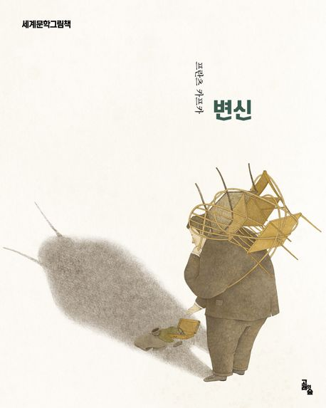

 

> 어느 날 아침, 그레고르 잠자는 불안(不安)한 꿈에서 깨어났을 때, 그는 침대 속에서 거대한 벌레로 변해 있는 자신을 발견(發見)했다.
>
> — 프란츠 카프카, 『변신』

문학(文學)사에서 가장 유명한 첫 문장 중 하나입니다. 설명도, 예고도 없이 이야기는 곧장 벌어집니다. 어제까지 성실(誠實)한 외판원이었던 한 남자가 아침에 눈을 떠 보니 벌레가 되어 있습니다. 카프카는 왜 벌레가 되었는지 끝내 설명하지 않습니다. 이유가 없기 때문입니다.

오히려 묻는 것은 따로 있습니다. 쓸모를 잃은 존재(存在)는 어떻게 대우받는가. 그레고르를 둘러싼 가족(家族)의 태도(態度)가 차츰 변해 가는 모습을 따라가다 보면, 변한 것은 몸만이 아니었음을 깨닫게 됩니다. 일상(日常)이 무너지는 순간, 사람의 자리를 지키는 것이 무엇인지 묻게 됩니다.

일요일 아침, 거창한 다짐 대신 가벼운 질문 하나를 품어 봅니다. 오늘 나를 나답게 만드는 것은 무엇일까. 그 답이 아직 또렷하지 않아도 괜찮습니다. 질문을 품은 채 하루를 시작하는 것만으로 충분합니다.
