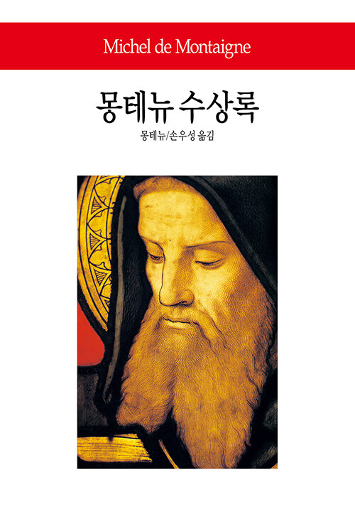
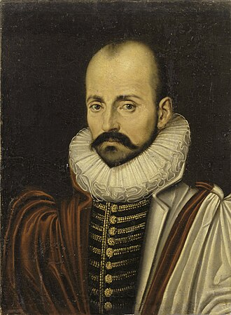

 

> 나는 나 자신을 다른 어떤 주제(主題)보다도 더 연구(硏究)한다. 이것이 나의 형이상학(形而上學)이며, 나의 물리학(物理學)이다.
>
> — 미셸 드 몽테뉴, 『수상록』

몽테뉴는 은퇴 후 탑 속 서재에 틀어박혀 자기 자신을 관찰하는 글을 썼습니다. 남의 삶을 평가하기 전에, 먼저 자기라는 연구(硏究) 대상을 들여다본 것입니다. 거창한 학문이 아니라, 매일의 기분과 습관과 판단을 차분히 기록하는 일이었습니다.

한 주의 시작인 월요일 아침, 남을 바꾸려 애쓰기 전에 나부터 살펴봅니다. 오늘 내가 왜 이렇게 반응했는지, 무엇을 피하고 있는지, 한 줄이라도 적어 보는 것만으로 충분합니다. 자기 이해(理解)가 먼저이고, 그 다음이 세상입니다.
