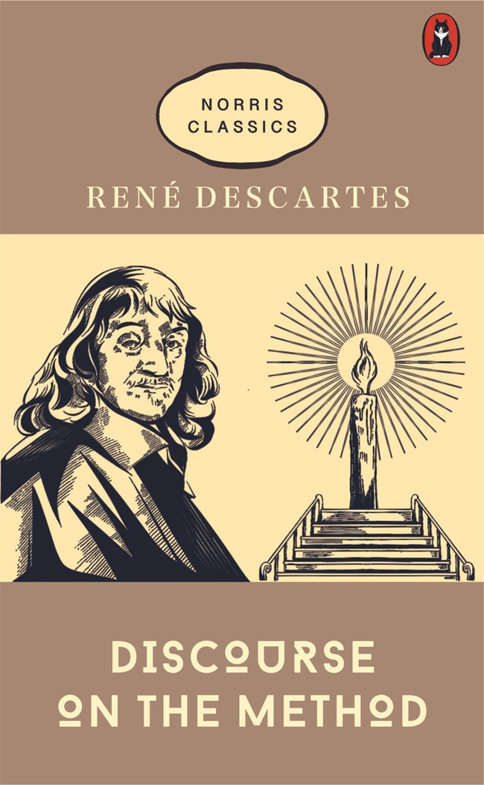
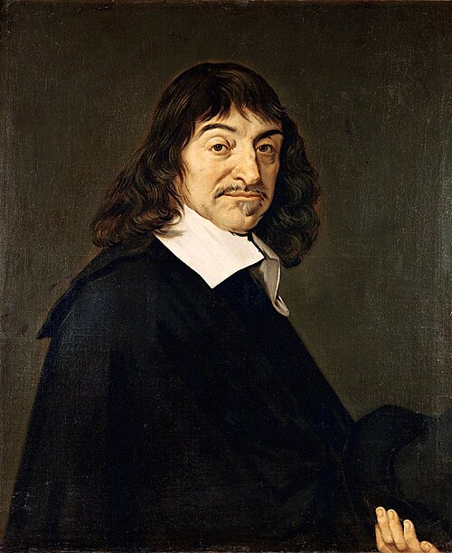

 

> 나는 생각한다, 고로 나는 존재(存在)한다.
>
> — 르네 데카르트, 『방법서설』

데카르트는 모든 것을 의심(疑心)해 보았다. 감각(感覺)도, 배운 지식(知識)도 의심(疑心)할 수 있었다. 그러나 의심(疑心)하고 있는 나만큼은 의심(疑心)할 수 없었다. 의심(疑心)한다는 사실(事實) 자체가 생각하고 있다는 증거(證據)였기 때문이다.

그래서 이 한 문장은 철학(哲學)의 출발점(出發點)이 되었다. 확실(確實)한 것이 아무것도 없어 보일 때, 그래도 남는 것이 있다. 바로 지금 생각하고 있는 나이다. 오늘의 생각과 선택(選擇)이 나의 존재(存在)를 만든다고 믿어 본다.
