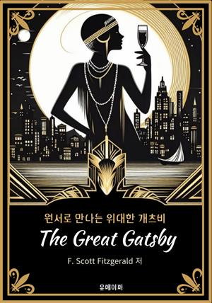
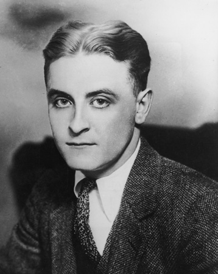

 

> 그래서 우리는 조류(潮流)를 거슬러 나아가는 배들처럼, 과거(過去) 속으로 끝없이 떠밀려 가면서도 앞으로 나아간다.
>
> — F. 스콧 피츠제럴드, 『위대한 개츠비』

소설의 마지막 문장입니다. 개츠비는 과거(過去)를 되찾으려 애썼지만, 결국 시간(時間)은 누구에게도 되돌려지지 않습니다. 그럼에도 배는 앞으로 나아갑니다. 밀려가면서도 나아간다는 이 모순(矛盾)이야말로 우리 하루의 모습이 아닐까요.

돌아갈 수 없는 어제를 붙잡는 대신, 오늘의 물살을 헤치며 한 뼘이라도 앞으로 가 봅니다.
