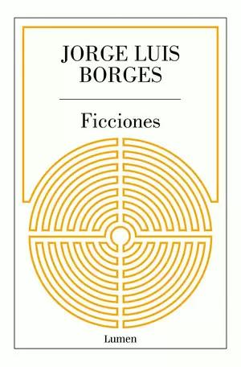

 

> 우주(宇宙) — 다른 사람들이 도서관(圖書館)이라 부르는 — 는 불확정(不確定)하고 어쩌면 무한(無限)한 수의 육각형(六角形) 회랑(回廊)들로 이루어져 있다.
>
> — 호르헤 루이스 보르헤스, 『픽션들』「바벨의 도서관」

보르헤스는 우주(宇宙)를 도서관(圖書館)으로 바꿔 놓고 시작합니다. 모든 책이 이미 어딘가에 꽂혀 있다는 상상(想象)은 무섭기도 하고, 동시에 위로가 되기도 합니다. 내가 모르는 것이 내 무지(無知)가 아니라, 아직 닿지 못한 복도(廊下) 하나일 수 있으니까요.

오늘 읽는 한 페이지도 그 거대한 도서관(圖書館)의 한 복도(廊下)라고 생각하면, 읽기가 조금은 가벼워집니다. 다 알 필요는 없습니다. 다음 복도로 한 걸음만 옮기면 됩니다.
