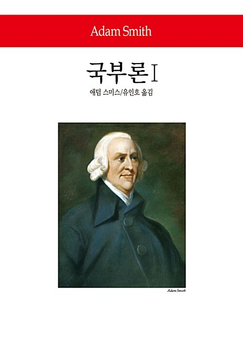

 

> 각 개인(個人)은 오직 자신의 이익(利益)만을 추구(追求)할 뿐이지만, 그는 보이지 않는 손에 이끌려, 자신이 의도(意圖)하지 않았던 목적(目的)을 달성(達成)하게 된다.
>
> — 애덤 스미스, 『국부론』

경제학(經濟學)의 아버지라 불리는 스미스가 남긴 가장 유명한 비유(比喩)입니다. 시장은 누구의 설계(設計)도 없이, 저마다 자기 이익(利益)을 좇는 사람들의 손길로 움직인다는 말이지요.

계획(計劃)대로 되지 않는 날이 수두룩합니다. 그런데도 큰 흐름은 각자의 자리에서 맡은 일을 해내는 손길들로 굴러갑니다. 보이지 않는 손은 경제(經濟)만의 이야기가 아닌가 봅니다.

오늘도 내 자리에서 할 일을 하면, 그 손길이 어딘가로 이어지겠지요.
