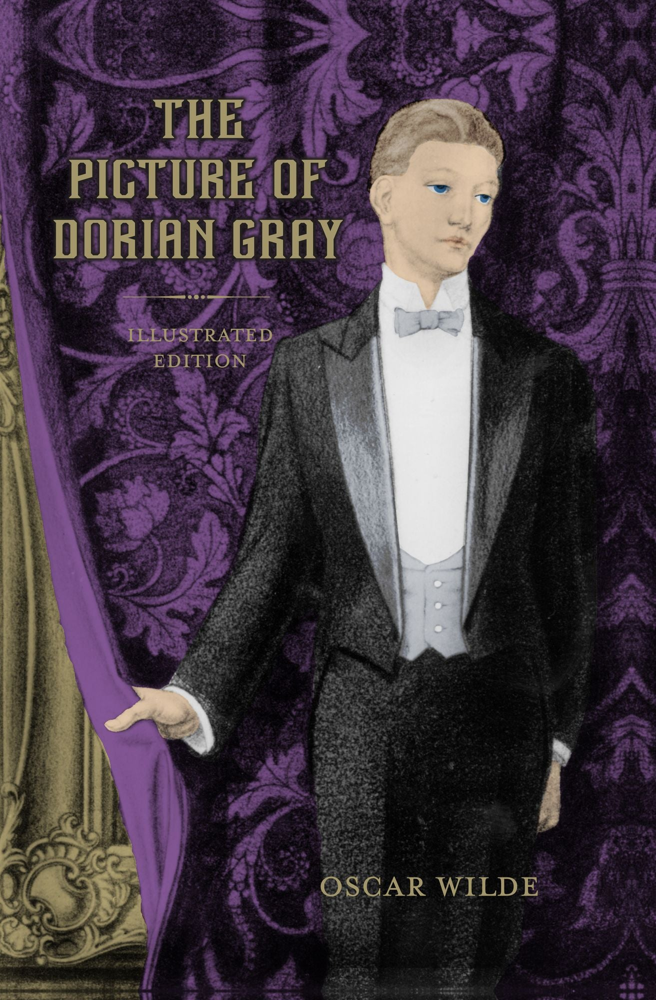
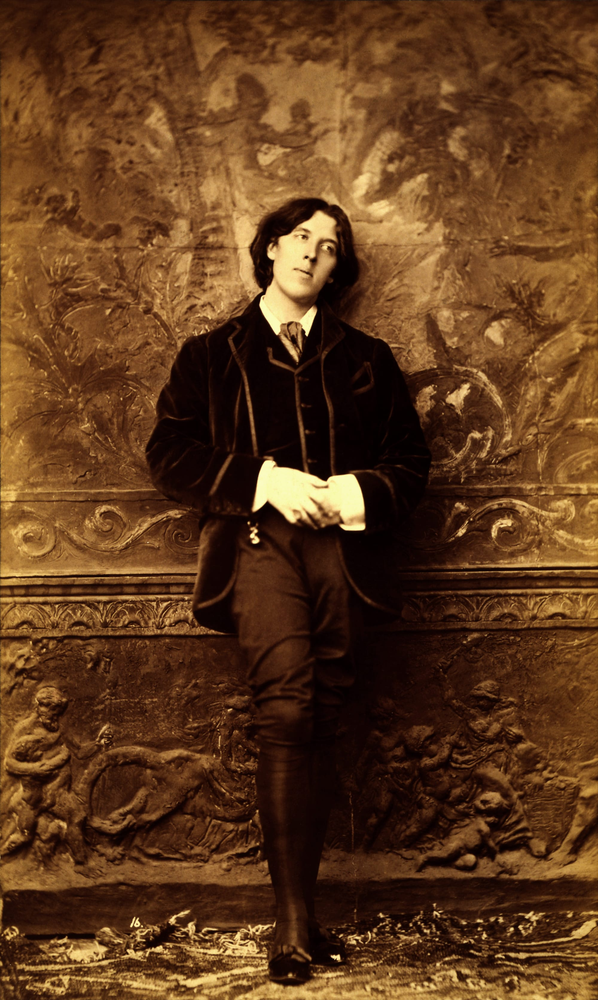

 

> 세상(世上)에서 남들의 입에 오르내리는 것보다 더 나쁜 일은 하나뿐이다. 그것은 아무도 나에 대해 말하지 않는 것이다.
>
> — 오스카 와일드, 『도리언 그레이의 초상』

와일드의 유일(唯一)한 장편(長篇) 소설 첫 장(章)에 나오는 헨리 경의 한마디입니다. 남의 입에 오르내리는 것을 두려워하는 사람들에게, 정작 무서운 건 아무도 거들떠보지 않는 것이라는 역설(逆說)이지요.

좋은 말이든 나쁜 말이든, 남의 관심(關心) 속에 있다는 것은 아직 세상과 연결(連結)되어 있다는 뜻이기도 합니다. 물론 와일드 특유(特有)의 과장(誇張) 섞인 농담이지만, 곱씹을수록 묘하게 남는 말입니다.

주말 아침, 남의 평가(評價)에 마음을 쓰기보다 오늘 내 하루를 어떻게 살 것인지 먼저 물어봅니다.
