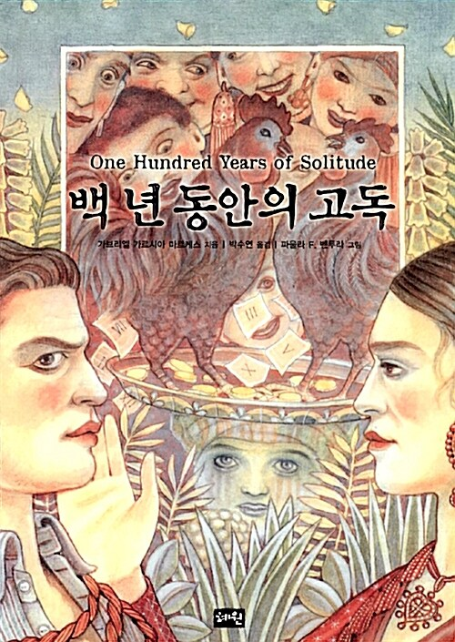

 

> 세상(世上)은 아직 너무 새로워서, 많은 것들이 이름이 없었고, 그래서 손가락으로 가리켜야 했다.
>
> — 가브리엘 가르시아 마르케스, 『백 년의 고독』

마콘도라는 마을이 막 태어나는 대목입니다. 집도 길도 갓 지어진 세상, 사물(事物)에는 아직 이름이 없어서 사람들은 손가락으로 가리키며 서로를 알아봅니다.

이름이 없다는 건, 세상을 아직 온전히 소유(所有)하지 않았다는 뜻이기도 합니다. 말이 닿기 전의 세상, 설명(說明)보다 먼저 손끝이 가리키는 세계(世界) — 문장(文章) 하나로 소설(小說) 전체(全體)의 시작(始作)이 열리는 느낌입니다.

일요일 아침, 오늘 하루는 이름 붙이기 전의 눈으로 바라봅니다. 익숙한 것들도 처음 만난 것처럼, 손가락으로 가리키듯 천천히.
