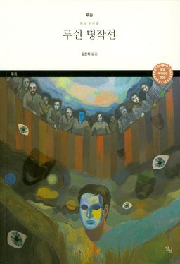

 

> 희망(希望)이란 원래(原來) 있는 것도 아니고 없는 것도 아니다. 마치 땅 위에 난 길과 같다. 본래(本來) 땅 위에 길은 없었지만, 걷는 사람이 많아지면 그것이 곧 길이 되는 것이다.
>
> — 루쉰, 『고향』

『고향』의 마지막 문장(文章)입니다. 스무 해 만에 고향(故鄕)으로 돌아온 '나'는, 다시 배에 오르며 희망(希望)에 대해 생각합니다. 희망(希望)이란 있는 것도 없는 것도 아니고, 땅 위에 난 길과 같다는 — 걷는 사람이 많아지면 길이 된다는 깨달음입니다.

길은 원래부터 있었던 것이 아닙니다. 누군가 먼저 한 걸음을 내디뎠고, 그 뒤를 또 누군가가 따라 걸었을 때 비로소 길이 되었습니다. 희망(希望)도 마찬가지입니다. 막연히 기다리는 것이 아니라, 오늘 내가 내딛는 한 걸음에서 시작됩니다.

월요일 아침, 수능을 앞둔 일주일의 시작입니다. 아이들이 각자의 길을 걷고 있을 시간, 오늘 내딛는 한 걸음이 내일의 길이 됩니다. 희망(希望)은 저 멀리에 있는 것이 아니라, 지금 걷고 있는 이 발걸음 속에 있습니다.
