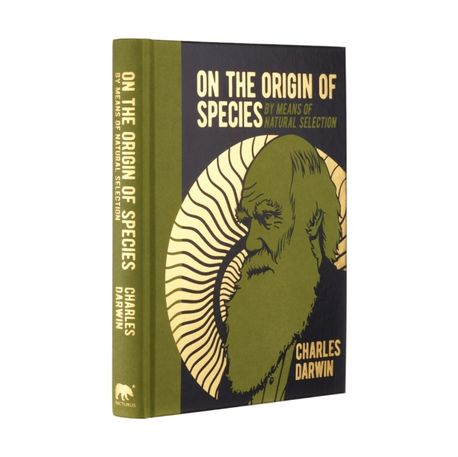
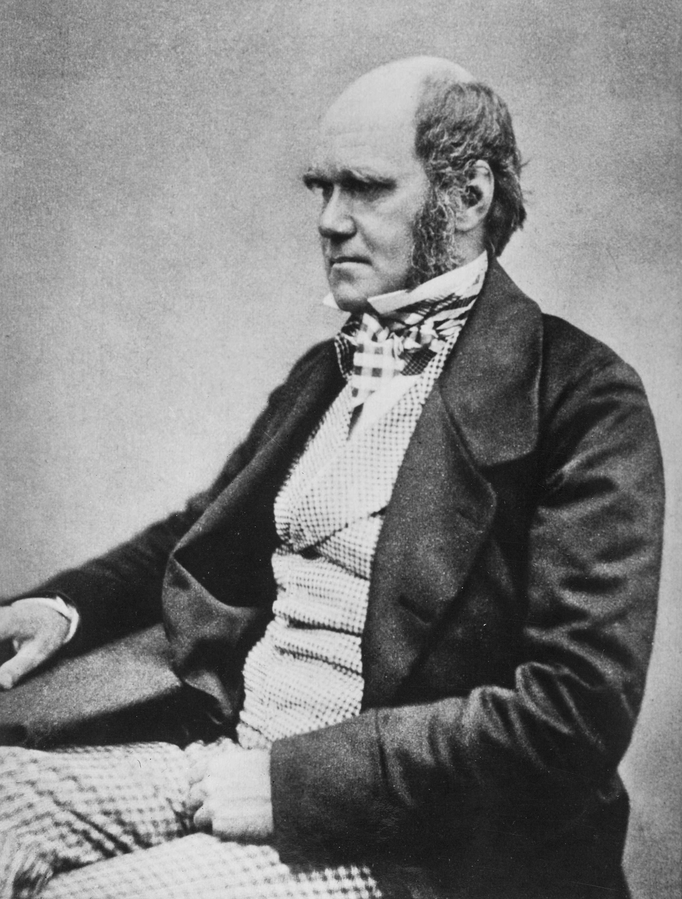

 

> 생명(生命)에 대한 이러한 견해(見解)에는 장엄함(壯嚴)이 있다. 그토록 단순(單純)한 시작(始作)으로부터 끝없이 아름답고 놀라운 무수한 형태들이 진화(進化)해 왔고, 지금도 진화(進化)하고 있다.
>
> — 찰스 다윈, 『종의 기원』

1859년 출간(出版)된 『종의 기원』의 마지막 문장(文章)입니다. 다윈은 비글호 항해(航海)부터 20여 년의 관찰(觀察)과 사유(思惟) 끝에, 이 한 문장으로 책을 닫았습니다. 단순(單純)한 시작(始作)에서 출발한 생명(生命)이, 긴 시간(時間)을 거쳐 끝없이 아름다운 형태들로 이어져 왔다는 선언(宣言)입니다.

장엄(壯嚴)하다는 말에 주목합니다. 다윈이 말하는 장엄함(壯嚴)은 거창한 기적(奇蹟)이 아니라, 아주 작은 변화(變化)가 아주 긴 시간(時間) 동안 쌓여 이루어 낸 결과(結果)에 대한 경외(敬畏)입니다. 오늘 우리가 보는 모든 생명(生命)은 그 긴 축적(蓄積)의 끝자락에 서 있습니다.

화요일 아침, 수능(修能)을 앞둔 일주일의 한가운데입니다. 아이들의 하루하루도 마찬가지입니다. 오늘의 작은 노력(努力)이 당장은 보이지 않아도, 그것들이 쌓여 결국에는 제 모습을 갖추게 됩니다. 단순(單純)한 시작(始作)이 끝없이 아름다운 형태가 되듯, 오늘 내딛는 한 걸음도 헛되지 않습니다.
