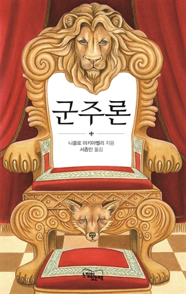
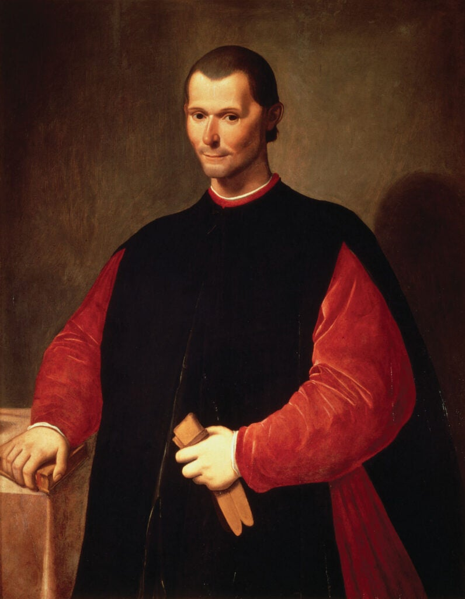

 

> 운명(運命)은 우리 행동(行動)의 절반(半)을 결정(決定)하지만, 나머지 절반(半)은 우리에게 맡겨져 있다.
>
> — 니콜로 마키아벨리, 『군주론』

『군주론』 25장의 문장(文章)입니다. 마키아벨리는 1513년, 피렌체에서 쫓겨난 채 시골 별장에 머물며 이 책을 썼습니다. 권력(權力)의 한가운데에 있다가 하루아침에 밀려난 사람에게, 운명(運命)은 남의 일이 아니었습니다.

그런 사람이 운명(運命)의 힘을 절반(半)으로 그은 것이 흥미롭습니다. 모든 것을 운(運)에 맡기지도, 모든 것을 의지(意志)로 해낼 수 있다고 과장(誇張)하지도 않았습니다. 절반(半)은 우리 손을 벗어나 있지만, 나머지 절반(半)은 분명히 우리에게 맡겨져 있다고 말합니다.

수능(修能)을 여드레 앞둔 수요일 아침입니다. 이미 치른 시간(時間)은 바꿀 수 없지만, 오늘 하루와 남은 여드레는 아직 우리 손에 있습니다. 운명(運命)이 정하는 절반(半)을 탓하기보다, 우리에게 맡겨진 절반(半)을 끝까지 채우는 하루가 되기를 바랍니다.
