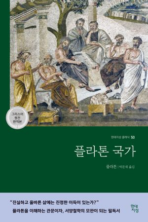
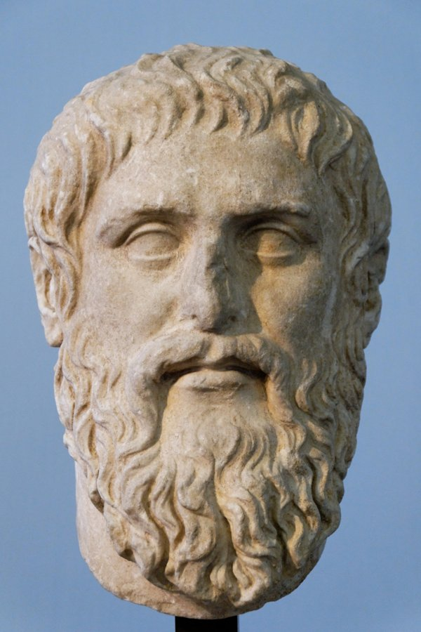

 

> 철학자(哲學者)가 왕(王)이 되거나, 왕(王)이 진정(眞正)으로 철학(哲學)을 하지 않는 한, 국가(國家)의 고통(苦痛)은 끝이 없을 것이다.
>
> — 플라톤, 『국가』

『국가』 제5권에서 소크라테스가 던진 유명한 구절입니다. 플라톤이 꿈꾼 나라는 권력(權力)을 가진 자가 진리(眞理)를 배우는 나라, 아는 자가 다스리는 나라였습니다. 이천사백 년이 지난 지금도 이 문장이 낯설지 않은 건, 아마 우리 시대에도 여전히 권력(權力)과 지혜(智慧)가 따로 놀고 있기 때문일 겁니다.

권력(權力)을 쥔 사람이 배우기를 멈추면, 그 나라는 고통(苦痛)에서 벗어날 수 없다는 경고(警告)입니다. 오늘 아침, 내 자리에서 내가 아는 것과 내가 하는 일이 얼마나 가까이 붙어 있는지 한 번 돌아봅니다.
