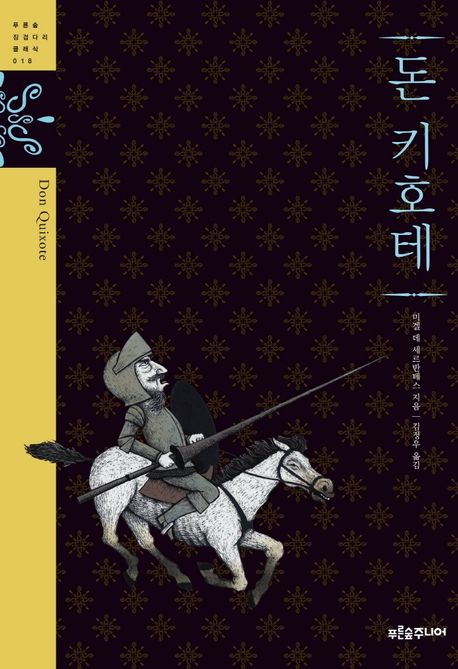
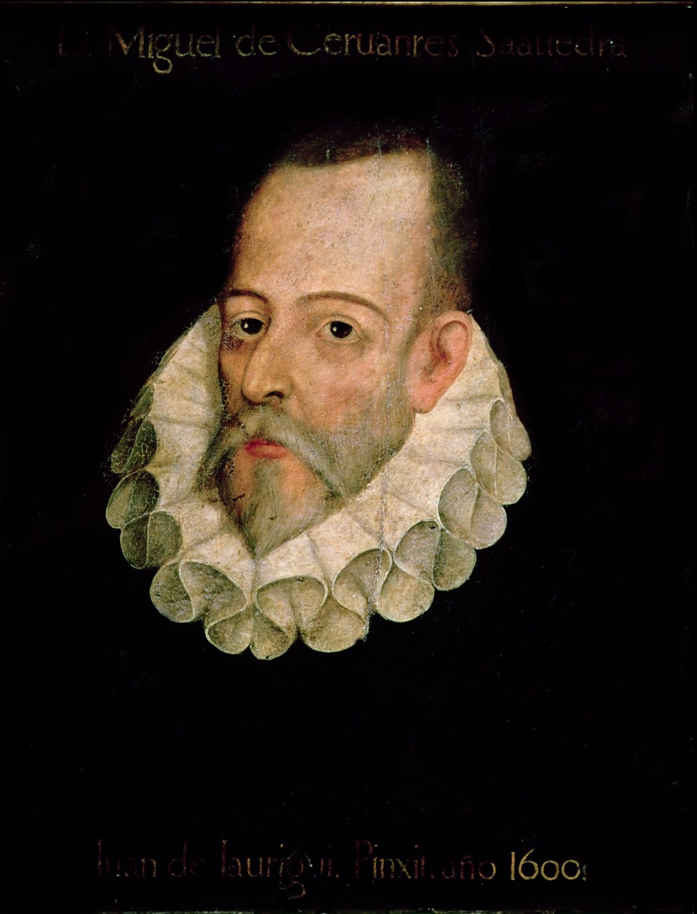

 

> 자유(自由)는 하늘이 인간(人間)에게 내린 가장 귀한 선물 중 하나이다.
>
> — 미겔 데 세르반테스, 『돈키호테』

풍차(風車)를 향해 창을 들고 돌진하는 기사(騎士)는, 세상(世上) 눈에는 미친 사람으로 보입니다. 그런데 그 우스꽝스러운 돌진 뒤에는 타협(妥協) 없는 한 가지가 있습니다. 남이 정해 준 삶을 살지 않겠다는 고집(固執), 곧 자유(自由)입니다.

자유(自由)를 '선물'이라 부른 말이 오래 남습니다. 선물은 당연히 주어지는 것이 아니라, 받은 뒤에 지켜야 하는 것이니까요. 오늘 내가 쓰는 자유(自由)가 어떤 모양인지, 그 가치(價値)를 한 번쯤 가늠해 봅니다.
