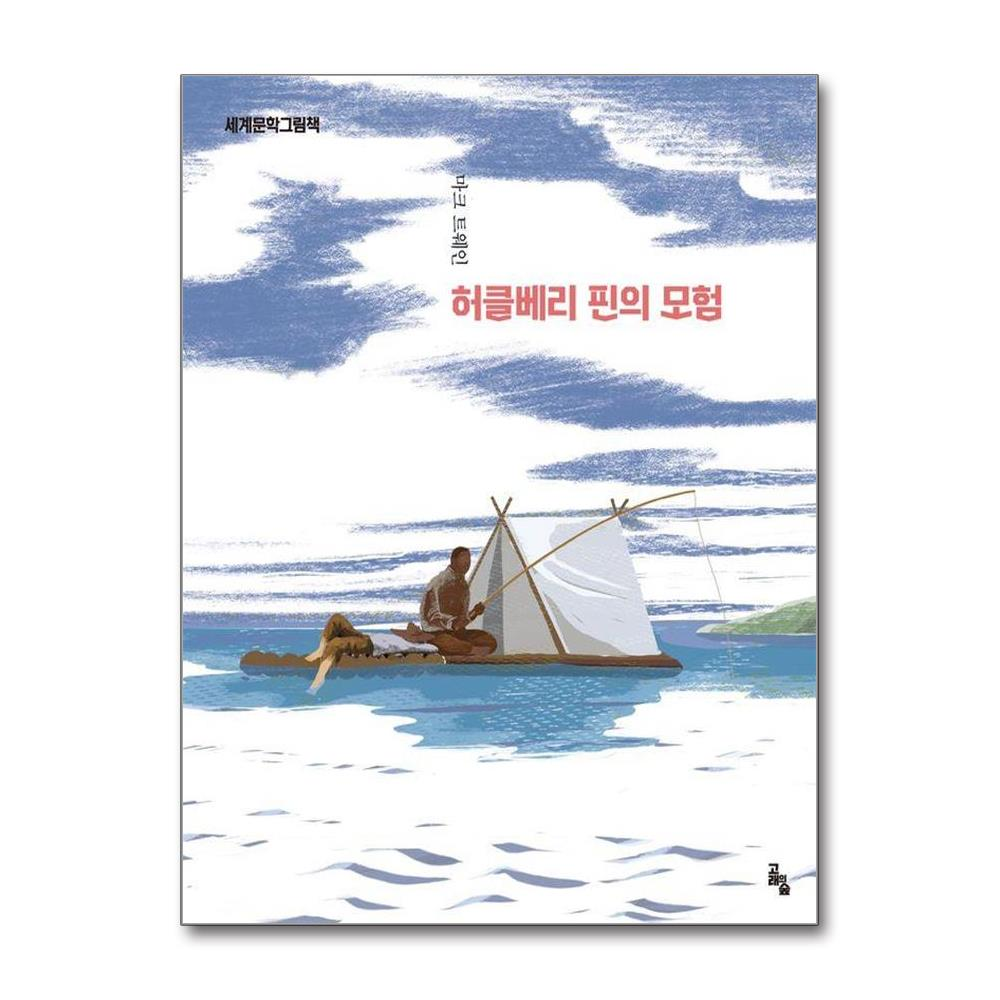
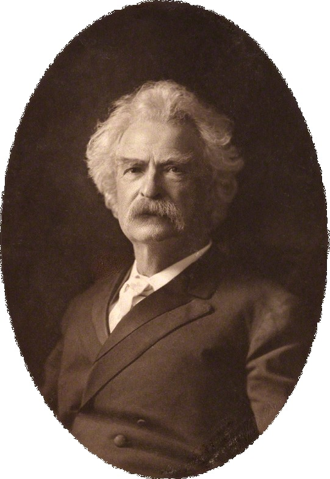

 

> 좋아, 그렇다면 나는 지옥(地獄)에 가겠어.
>
> — 마크 트웨인, 『허클베리 핀의 모험』

도망친 노예(奴隸) 짐을 도와주던 헉 핀은 양심(良心)의 가책(苛責)에 시달립니다. 당시의 법(法)과 도덕(道德)은 짐을 주인에게 돌려보내라고 가르쳤으니까요. 그러나 헉은 끝내 편지를 찢어버리고 이렇게 말합니다. 세상이 정한 지옥(地獄)이라도, 친구를 지키는 쪽을 택하겠다는 결심(決心)입니다.

옳고 그름을 가르는 잣대가 언제나 내 편에 서 있는 것은 아닙니다. 누군가는 그 잣대를 의심해 볼 용기(勇氣)가 필요합니다. 토요일 아침, 헉의 한마디가 오래 남습니다.
