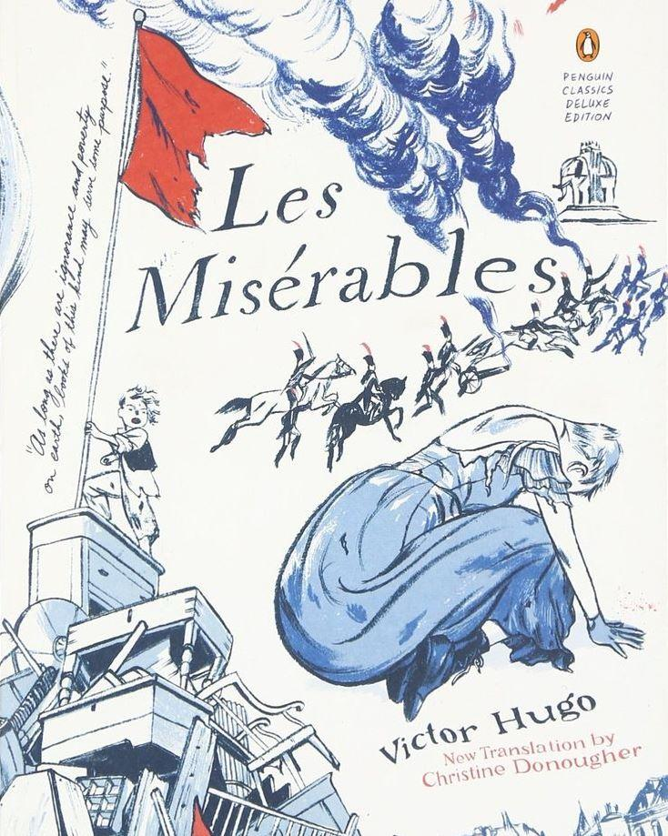
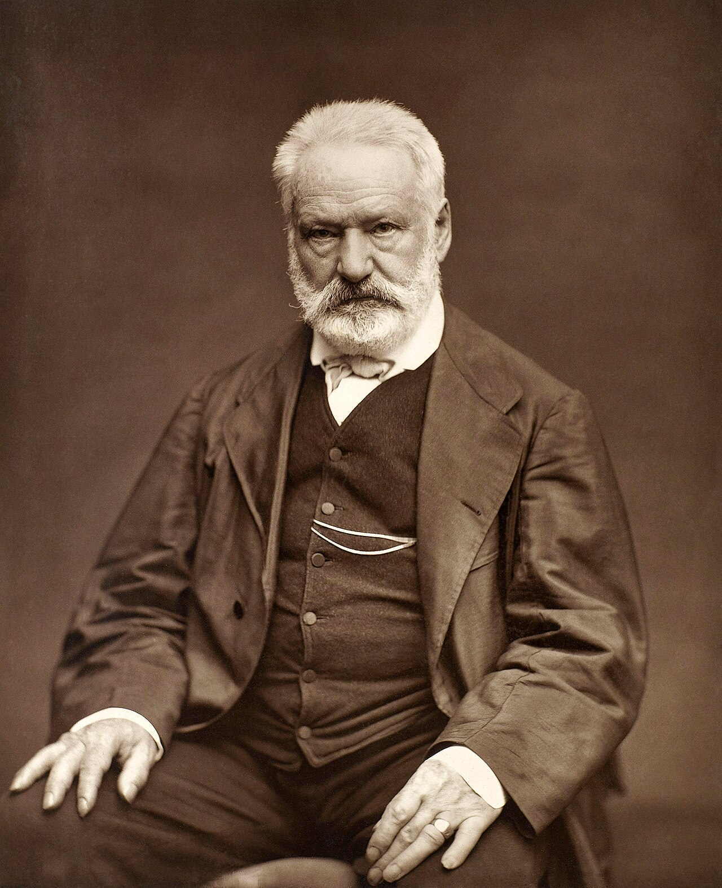

 

> 인생(人生)에서 가장 큰 행복(幸福)은, 우리가 사랑(愛)받고 있다는 확신(確信)이다.
>
> — 빅토르 위고, 『레 미제라블』

장발장은 죄수(罪囚) 번호 24601로 시작했습니다. 사회(社會)가 그에게 찍어 준 낙인(烙印)은 '다시는 믿을 수 없는 사람'이었습니다. 그러나 미리엘 주교(主敎)가 내민 은(銀)촛대와 "이제 당신은 선(善)한 사람이 되어야 합니다"라는 한마디가 그를 바꾸었고, 코제트를 향한 사랑(愛)이 그 변화(變化)를 끝까지 붙들었습니다. 사랑받고 있다는 확신(確信)이 한 사람의 남은 삶을 통째로 뒤집은 셈입니다.

확신(確信)이라는 말이 좋습니다. 사랑(愛)이 느껴질 때가 아니라, 사랑받고 있다고 믿을 수 있을 때 비로소 사람은 자기 자신을 용서(容恕)하고 다시 일어섭니다. 일요일 아침, 곁에 있는 누군가에게 사랑받고 있다는 확신(確信)을 건네는 하루가 되면 좋겠습니다.
