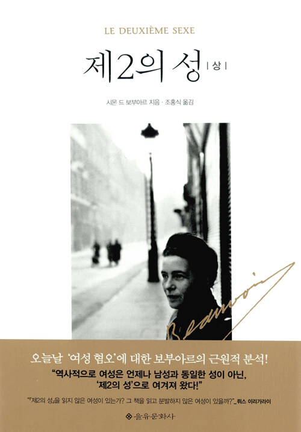

 

> 여성(女性)은 태어나는 것이 아니라 만들어지는 것이다.
>
> — 시몬 드 보부아르, 『제2의 성』

1949년에 나온 『제2의 성』의 첫 문장에 가까운 이 한 줄은, 여성(女性)이라는 존재(存在)가 타고나는 것이 아니라 사회(社會)가 만들어 낸 역할(役割)이라고 말합니다. 생물학적(生物學的)인 차이(差異)를 부정(否定)한 것이 아니라, 그 차이(差異)에 붙은 의미(意味)와 운명(運命)은 사회(社會)가 정한 것이라는 지적(指摘)이었습니다.

이 문장이 70년이 넘도록 인용(引用)되는 이유(理由)는, '여성(女性)'이라는 자리만 바꾸면 다른 많은 고정관념(固定觀念)에도 그대로 들어맞기 때문입니다. 타고났다고 믿었던 것들이 실은 만들어진 것이라면, 우리는 그것을 다시 만들 수도 있습니다. 월요일 아침, "나는 원래 이런 사람이니까"라는 말 앞에 잠깐 멈춰 서 봅니다. 그 말이 사실(事實)인지, 누군가 만들어 준 틀인지, 한 번쯤 물어볼 만합니다.
