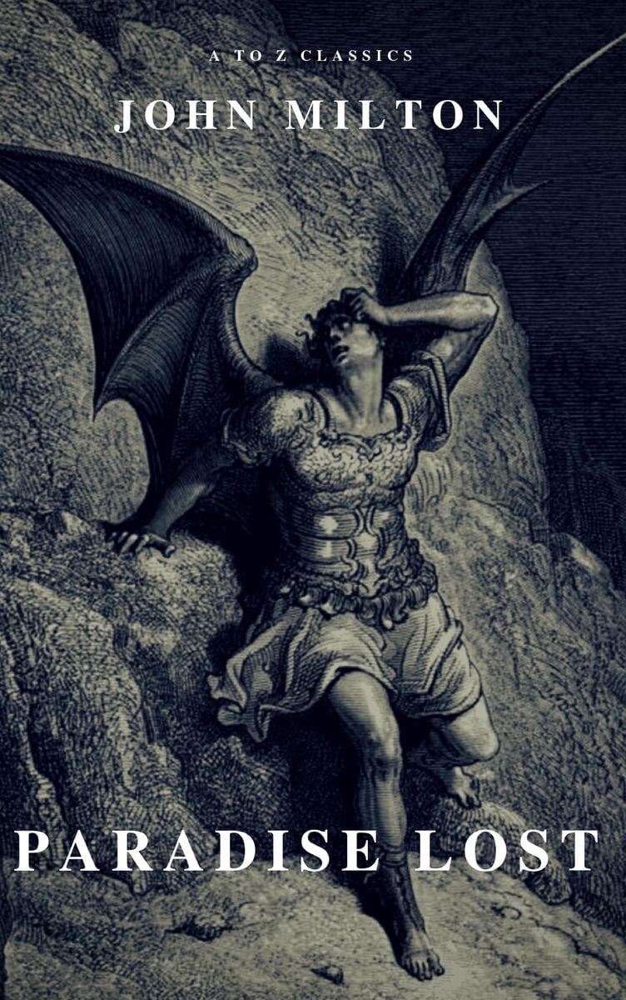

 

> 마음은 그 자체로 하나의 장소(場所)이다. 그 안에서 지옥(地獄)을 천국(天國)으로, 천국(天國)을 지옥(地獄)으로 만들 수 있다.
>
> — 존 밀턴, 『실낙원』

이 말은 지옥(地獄)에 떨어진 사탄의 입에서 나옵니다. 모든 것을 잃은 자리에서 그에게 남은 마지막 자유(自由)가 바로 마음가짐이었던 셈입니다.

환경(環境)은 마음대로 되지 않지만, 그 환경을 어떻게 받아들이고 해석(解釋)할지는 내 몫입니다. 수능을 이틀 앞둔 아침, 마음을 다잡는 일이 곧 하루를 다잡는 일이라는 생각이 듭니다.

천국(天國)과 지옥(地獄)은 먼 곳에 있는 것이 아니라, 오늘 내가 품는 마음속에 있다는 것. 그 사실을 기억(記憶)하며 하루를 시작합니다.
