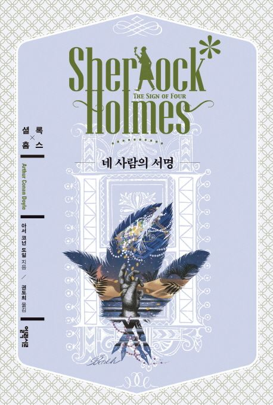
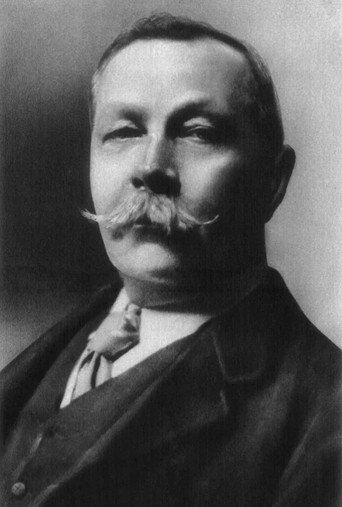

 

> 불가능(不可能)한 것을 제거(除去)하고 나면, 아무리 일어날 것 같지 않은 일이라도 진실(眞實)일 수밖에 없다.
>
> — 아서 코난 도일, 『네 사람의 서명』

이 말은 셜록 홈즈가 왓슨에게 건네는 추리(推理)의 원칙(原則)입니다. 가능성(可能性)이 아무리 많아 보여도, 불가능(不可能)한 것을 하나씩 지워 나가다 보면 마지막에 남는 것 하나가 답이 됩니다.

답을 찾는 일은 새로운 것을 더하는 일이 아니라, 아닌 것을 덜어내는 일이라는 뜻이기도 합니다. 수능을 하루 앞둔 아침, 머릿속이 복잡(複雜)하게 느껴진다면 지워야 할 것부터 지워 보는 건 어떨까요. 남은 것은 생각보다 단순(單純)할지 모릅니다.

오늘 하루, 불가능(不可能)한 것을 하나씩 덜어내며 마지막에 남는 확실(確實)한 것 하나를 믿고 나아갑니다.
