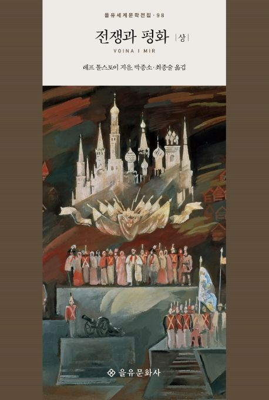
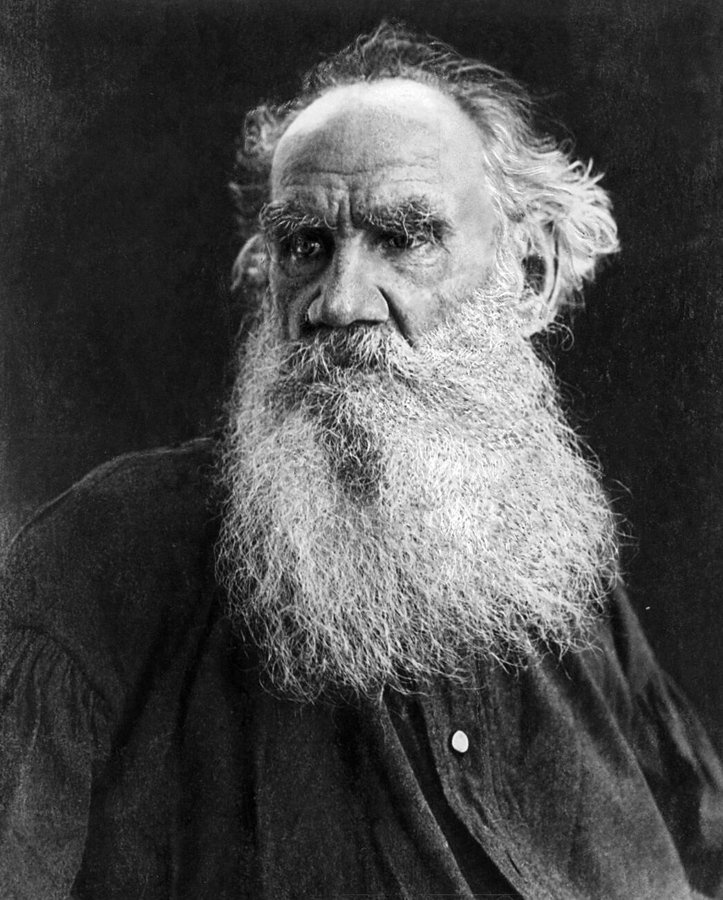

 

> 가장 강한 두 명의 전사(戰士)는 인내(忍耐)와 시간(時間)이다.
>
> — 레프 톨스토이, 『전쟁과 평화』

이 말은 나폴레옹과의 전쟁(戰爭)에서 러시아군을 이끈 쿠투조프 장군의 말입니다. 적(敵)과 맞서 싸우는 가장 강한 무기는 칼도, 대포(大砲)도 아니라, 기다릴 줄 아는 인내(忍耐)와 흐르는 시간(時間)이라는 뜻입니다.

서두른다고 이기는 것이 아니라, 견디는 자가 이긴다는 말입니다. 오늘은 수능 당일입니다. 지금까지 걸어온 시간(時間) 그 자체가 이미 가장 강한 전사(戰士)입니다. 오늘 아침, 새로운 것을 더하려 애쓰기보다 그간 쌓아 온 시간(時間)을 믿고, 차분(沈着)하게 한 문제(問題)씩 마주하면 됩니다.

인내(忍耐)와 시간(時間)이 내 편이라는 것을 기억(記憶)하며, 오늘 하루를 차분(沈着)하게 걸어갑니다.
