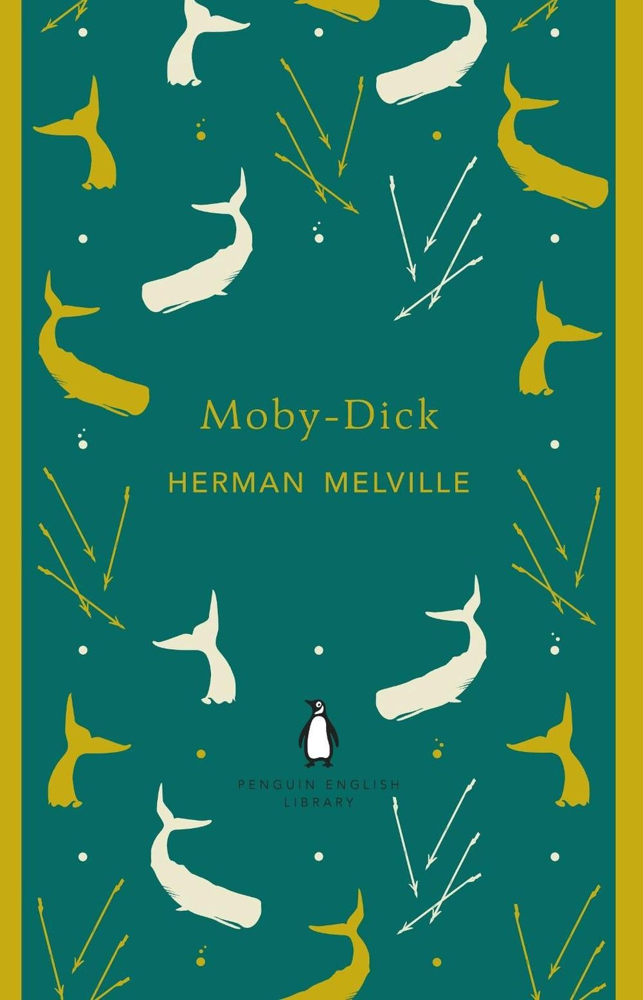
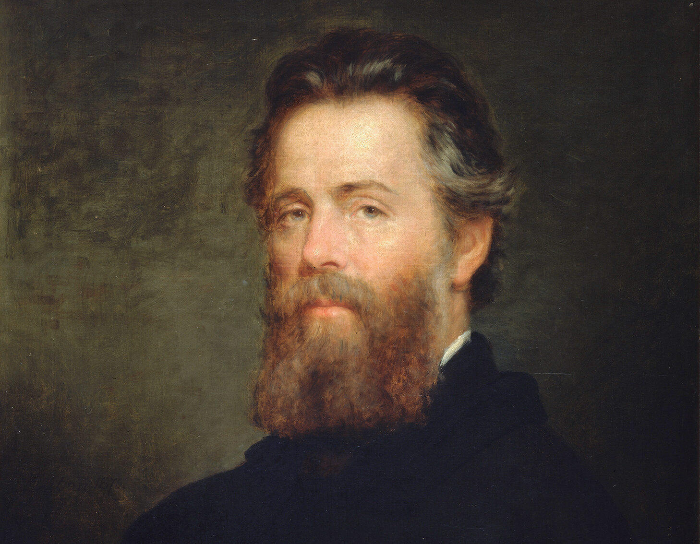

 

> 나를 이스마엘이라 부르시오. 몇 해 전 — 정확히 몇 해인지는 중요하지 않다 — 지갑에는 돈이 거의 없고 육지에서는 별로 관심을 끌 만한 일이 없어서, 잠시 항해(航海)하며 세계(世界)의 수역(水域)을 둘러보겠다고 생각했다.
>
> — 허먼 멜빌, 『모비딕』

미국(美國) 소설(小說) 사상(史上) 가장 널리 알려진 첫 문장 가운데 하나입니다. 화자(話者)는 자기 이름이 무엇인지 밝히지 않고, 이스마엘이라 부르라고만 말합니다. 본명(本名)인지 가명(假名)인지 알 수 없는 그 한마디에 떠돌이의 삶이 압축(壓縮)되어 있습니다.

지갑이 비고 육지(陸地)에서 할 일이 없을 때 바다로 나가는 사람. 멜빌은 그 출항(出航)을 거창한 모험(冒險)이 아니라 조용한 고백(告白)으로 시작(始作)합니다. 오늘 하루가 답답하다면, 이스마엘처럼 잠시 다른 수역(水域)을 둘러보는 마음으로 시작(始作)해 보아도 좋겠습니다.
