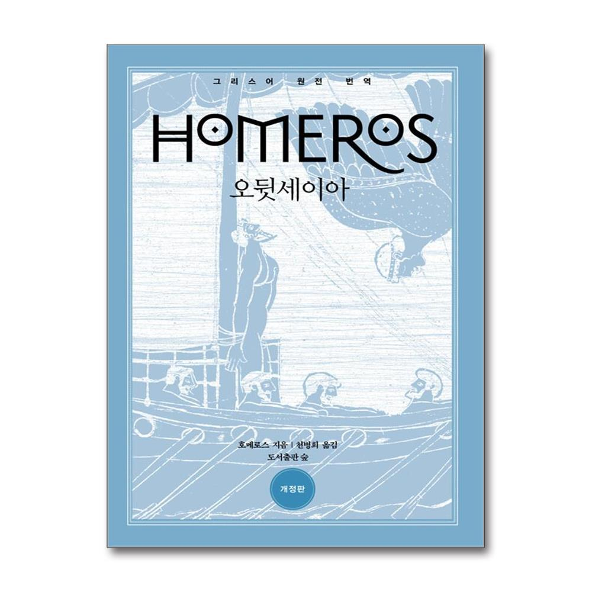

 

> 노래하라, 뮤즈여, 임기응변(臨機應變)에 능(能)한 그 사내의 이야기를.
>
> — 호메로스, 『오디세이아』

서양(西洋) 문학(文學)의 출발점(出發點)에 놓인 서사시(敍事詩)의 첫 행(行)입니다. 시인(詩人)은 자기 목소리가 아니라 뮤즈에게 노래를 청(請)합니다. 주인공(主人公)은 이름이 아니라 '임기응변(臨機應變)에 능(能)한 사내'라는 별명(別名)으로 소개(紹介)됩니다.

트로이 전쟁(戰爭)이 끝난 뒤에도 집으로 돌아오지 못한 오디세우스의 오랜 방랑(放浪)이 이 한 줄에서 시작(始作)됩니다. 힘으로 이기는 영웅(英雄)이 아니라, 꾀와 인내(忍耐)로 살아남는 사람의 이야기라는 선언(宣言)이기도 합니다. 오늘 하루, 부딪히는 일 앞에서 임기응변(臨機應變)의 지혜(智慧)를 떠올려 봅니다.
