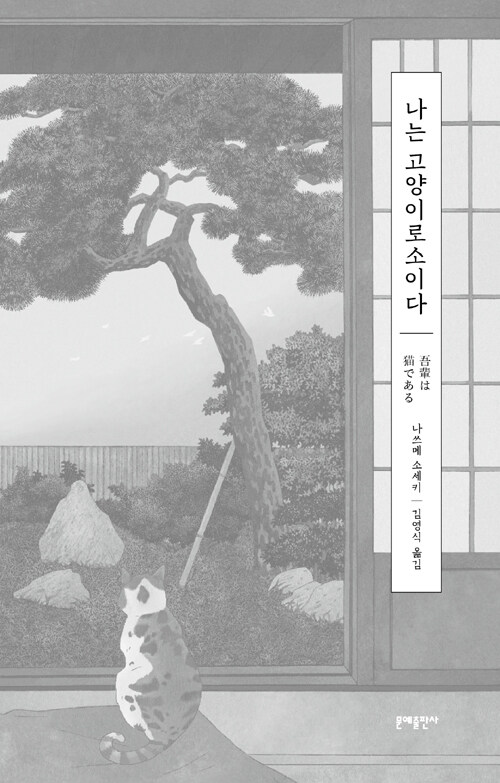
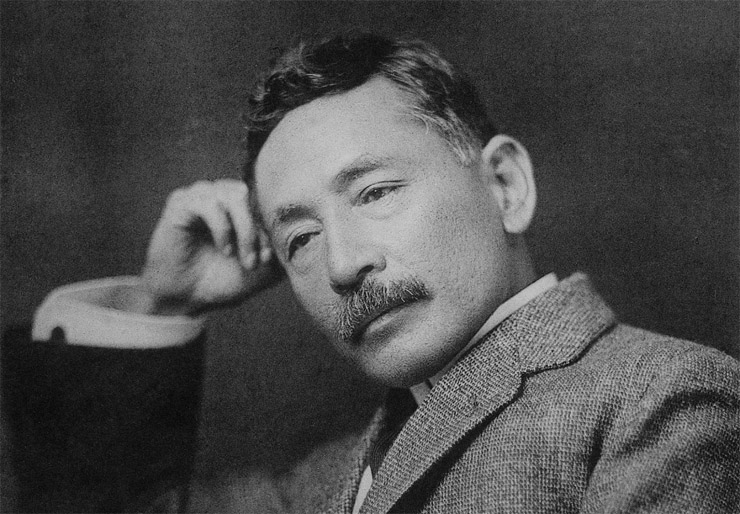

 

> 나는 고양이다. 이름은 아직 없다.
>
> — 나쓰메 소세키, 『나는 고양이로소이다』

일본(日本) 근대(近代) 문학(文學)을 대표(代表)하는 작가(作家) 나쓰메 소세키의 첫 소설(小說)이자 출세작(出世作)의 첫 문장(文章)입니다. 화자(話者)는 사람이 아니라, 이름조차 없는 한 마리 고양이입니다. 그 고양이의 눈을 빌려 인간(人間)의 허세(虛勢)와 사회(社會)의 풍경(風景)을 풍자(諷刺)합니다.

이름이 없다는 것은, 세상(世上)이 붙여 준 이름 없이도 존재(存在)할 수 있다는 선언(宣言)처럼 읽힙니다. 고양이는 주인(主人)의 집 구석에서 인간(人間)들을 가만히 관찰(觀察)하며, 때로는 인간(人間)보다 더 인간(人間)답게 세상(世上)을 봅니다. 일요일(日曜日) 아침, 이름 잠깐 내려놓고 고양이처럼 느긋하게 세상(世上)을 바라보는 하루이면 좋겠습니다.
