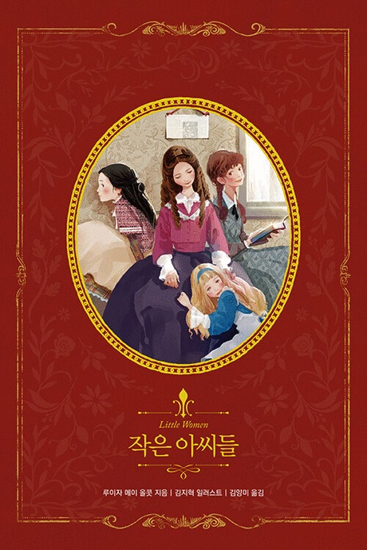

 

> 나는 폭풍(暴風)을 두려워하지 않는다. 배를 어떻게 조종(操縱)해야 하는지 배우는 중이니까.
>
> — 루이자 메이 올컷, 『작은 아씨들』

미국(美國) 작가(作家) 루이자 메이 올컷의 소설(小說) 『작은 아씨들』은 서로 다른 꿈을 품은 네 자매(姉妹)의 성장(成長)을 그린 작품(作品)입니다. 이 문장(文章)은 주인공(主人公) 조가 삶의 고난(苦難)을 배의 항해(航海)에 비유(比喩)하며 한 말로 널리 읽힙니다.

폭풍(暴風)을 두려워하지 않는다는 것은 고난(苦難)이 없다는 뜻이 아닙니다. 배를 조종(操縱)하는 법(法)을 배우는 중이라는 말은, 서툴러도 키를 놓지 않겠다는 태도(態度)에 가깝습니다. 월요일(月曜日) 아침, 오늘 하루도 그렇게 배워 가며 건너면 좋겠습니다.
