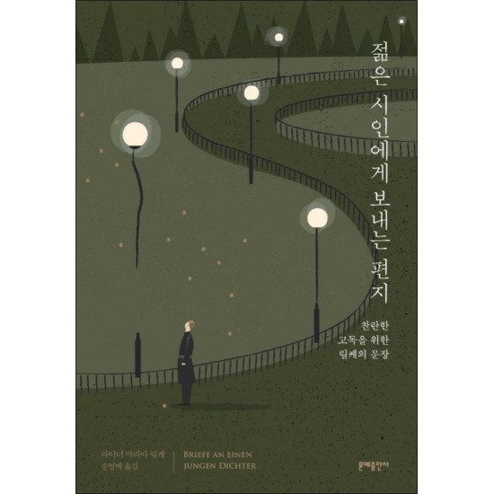
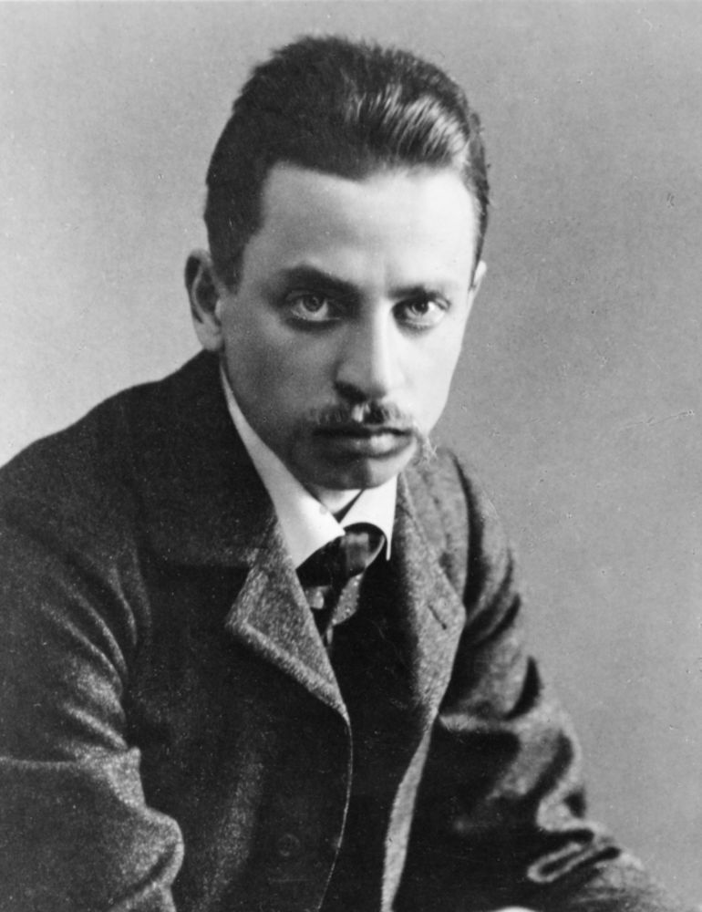

 

> 마음속의 풀리지 않는 모든 것을 인내(忍耐)로 사랑(愛)하라. 그 질문(質問) 자체(自體)를 사랑(愛)하라.
>
> — 라이너 마리아 릴케, 『젊은 시인에게 보내는 편지』

오스트리아 시인(詩人) 라이너 마리아 릴케가 젊은 시인 지망생(志望生)에게 보낸 편지(便紙)들을 모은 책(冊)입니다. 답(答)을 서두르지 말라는 이 문장(文章)은, 풀리지 않는 질문(質問)을 없애야 할 문제(問題)가 아니라 함께 살아야 할 동반자(同伴者)로 보라고 권합니다.

인내(忍耐)로 사랑(愛)한다는 말은 답답함을 참으라는 뜻만이 아닙니다. 질문(質問)이 나를 바꾸는 시간(時間)을 허락(許諾)하라는 뜻에 가깝습니다. 화요일(火曜日) 아침, 아직 답(答)이 없는 일 하나쯤은 서두르지 않고 데리고 가도 좋겠습니다.
