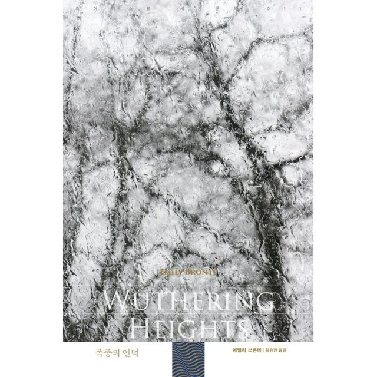
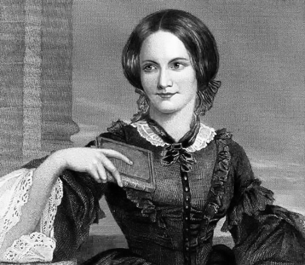

 

> 우리 영혼(靈魂)이 무엇으로 만들어졌든, 그와 나는 같다.
>
> — 에밀리 브론테, 『폭풍의 언덕』

캐서린이 히스클리프에게 하는 말입니다. 사랑(愛)이라는 단어가 이 소설(小說)에서는 소유(所有)도 약속(約束)도 아닙니다. 두 사람이 같은 재료(材料)로 만들어졌다는 선언(宣言)에 가깝습니다.

서로를 닮았다는 말이 아니라, 애초에 하나였다는 말입니다. 그래서 이 문장은 달콤하지 않습니다. 떼어낼 수 없는 인연(因緣)의 무게를 말합니다.

오늘 아침, 나와 같은 재료(材料)로 만들어진 사람이 누구인지 떠올려 봅니다. 가까이에 있다면, 그 인연(因緣)을 가볍게 여기지 않기를.
