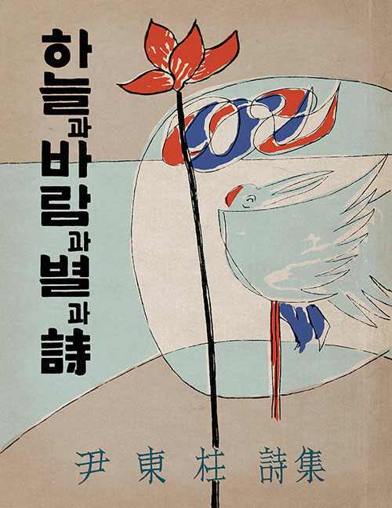
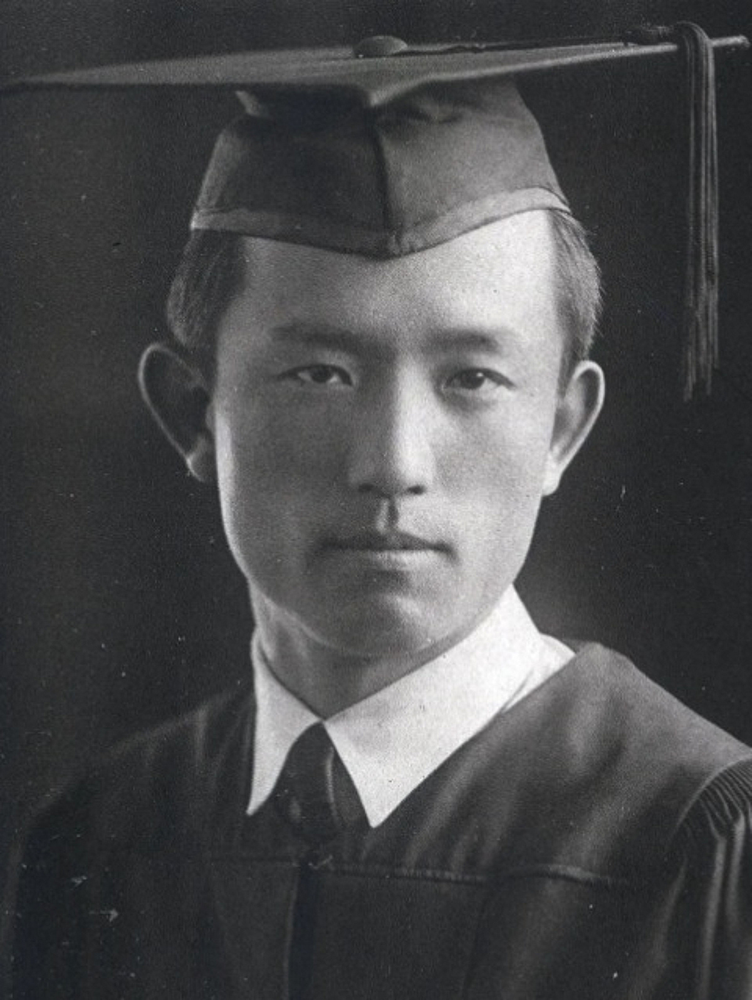

 

> 죽는 날까지 하늘을 우러러 한 점 부끄럼이 없기를, 잎새에 이는 바람에도 나는 괴로워했다.
>
> — 윤동주, 『하늘과 바람과 별과 시』

이 시는 시집의 첫머리에 놓인 「서시(序詩)」입니다. 윤동주가 스물네 살에 쓴 시로, 시인이 세상을 떠난 뒤 1948년 유고(遺稿) 시집으로 출간(出刊)되었습니다. 하늘을 우러러 부끄럼이 없기를 바라는 마음이, 잎새에 이는 바람 같은 작은 일에도 괴로워하는 마음과 한 문장에 나란히 놓여 있습니다.

부끄럼 없는 삶이 거창한 결심(決心)에서 오는 게 아니라는 것, 사소한 일에도 괴로워할 줄 아는 마음에서 시작된다는 것이 이 문장의 힘입니다. 오늘 하루, 잎새의 바람 같은 작은 일 하나에도 부끄럽지 않게 살아 봅니다.
