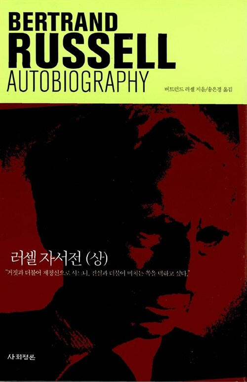
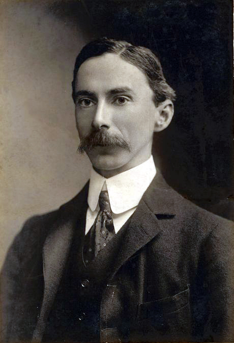

 

> 세 가지 열정이 — 단순(單純)하지만 압도적(壓倒的)으로 강력한 — 내 삶(生)을 지배(支配)해 왔다. 사랑(愛)에 대한 갈망(渴望), 지식(知識)에 대한 탐구(探究), 그리고 인류(人類)의 고통(苦痛)에 대한 참을 수 없는 연민(憐憫)이 바로 그것이다.
>
> — 버트런드 러셀, 『자서전』

러셀은 자신의 긴 삶을 이렇게 한 줄로 요약(要約)했습니다. 사랑(愛), 지식(知識), 연민(憐憫). 세 가지 열정(熱情)이 그를 움직였다고.

철학자(哲學者)라면 지식(知識)만으로 충분(充分)하다고 생각하기 쉽지만, 러셀은 사랑(愛)과 연민(憐憫)을 나란히 놓았습니다. 아는 것과 사랑하는 것, 그리고 남의 아픔을 외면(外面)하지 않는 것. 그 세 가지가 함께 있을 때 비로소 한 사람의 삶이 온전해진다는 뜻이겠지요.

오늘 하루, 내 삶을 움직이는 열정(熱情)이 무엇인지 한 번 물어봅니다. 답이 세 가지가 아니어도 괜찮습니다. 다만 그 답이 나만의 것이기를.
